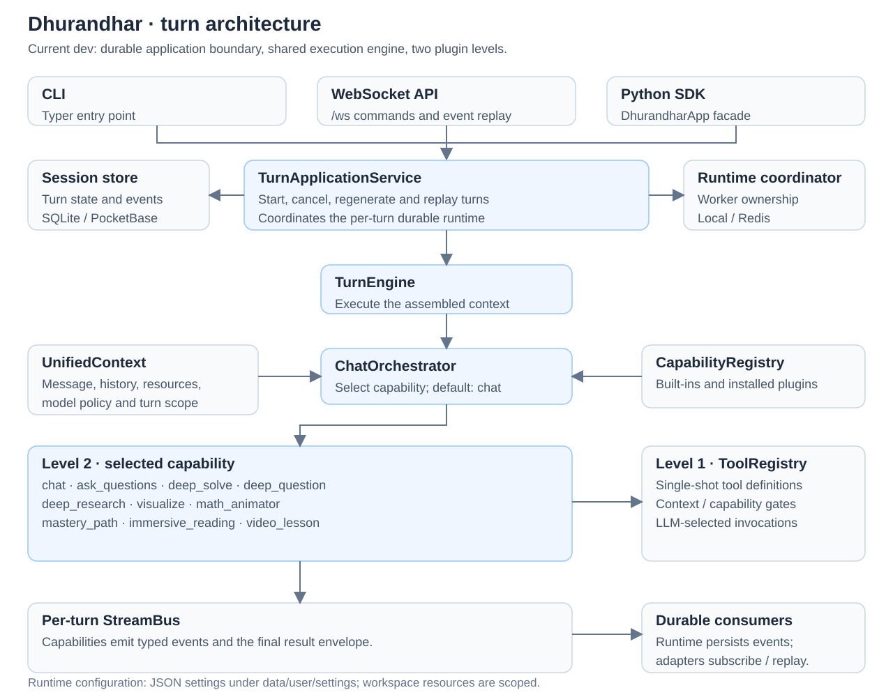

<div align="center">


# Dhurandhar Tutor

**A study workspace with an agent that remembers the work.**

[](LICENSE)
[](#status)
[](pyproject.toml)
[](web/package.json)

</div>

---

Dhurandhar Tutor is a local-first learning environment: one place to read, ask,
write, practise, and keep going across sessions. It runs on your machine, keeps
your material on your disk, and talks to whichever model provider you configure.

<p align="center">
  
</p>

## Why it feels different

- **It remembers.** Sessions build a layered memory — traces, facts, and
  synthesis — that you can inspect and edit instead of trusting a black box.
- **It reads with you.** Open a PDF, EPUB, DOCX, or video and ask inside it.
  Answers come back with source links into the exact passage.
- **It keeps the work in one pane.** Chat, notes, practice, a task board,
  calendar, and a reader share the same workspace, so context does not reset
  every time you change tools.
- **It is yours.** Models, providers, knowledge bases, personas, skills, MCP
  services, and CLI apps are all configured locally. No account is required to
  start.

## What is inside

| Area | What you get |
| --- | --- |
| **Chat** | Multi-turn agent loop with tools, attachments, citations, and side threads |
| **Learning** | Books, Immersive Reading, Mastery Path, Practice, and question banks |
| **Resources** | Knowledge bases, favourites, learning journal, and chat history |
| **Creation** | Co-Writer canvas, notebooks, visualisations, and video lessons |
| **Memory** | L1 traces, L2 facts, L3 synthesis, and an auditable memory graph |
| **Agents** | Personas, skills, subagents, MCP services, and CLI apps |
| **Planning** | Task board, calendar with `.ics` export, and study reminders |

## Quick start

**Requirements:** Python 3.11–3.14 and Node.js 22 LTS.

```bash
git clone https://github.com/Wadhawnaiya/dhurandhar-tutor.git
cd dhurandhar-tutor

python3 -m venv .venv && source .venv/bin/activate
python -m pip install --upgrade pip
python -m pip install -r requirements/full.txt
python -m pip install -e . --no-deps
( cd web && npm ci --legacy-peer-deps )

dhurandhar init      # pick ports, provider, and model
dhurandhar start     # backend + web app
```

Open the URL printed in the terminal — by default
[http://127.0.0.1:3782](http://127.0.0.1:3782) — then choose a provider and
model under **Settings → Providers** and **Language models**.

<details>
<summary><b>Minimal terminal-only install</b></summary>

No Node.js needed if you only want the CLI:

```bash
python -m pip install -e . --no-deps
dhurandhar init --cli
dhurandhar chat
```

</details>

<details>
<summary><b>Docker</b></summary>

```bash
docker build -t dhurandhar-tutor .
docker run --rm --name dhurandhar-tutor \
  -p 127.0.0.1:3782:3782 \
  -v dhurandhar-data:/app/data \
  dhurandhar-tutor
```

The named volume keeps settings and local data between runs.

</details>

<details>
<summary><b>Configuration and data</b></summary>

Runtime state lives under `data/user/settings/` inside the launch directory.
Set `DHURANDHAR_HOME` (or pass `dhurandhar start --home PATH`) to move it.
Project `.env` files are intentionally ignored; provider credentials are
written through the app's settings screens.

Useful documents: [architecture](docs-for-dev/ARCHITECTURE.md),
[development](docs-for-dev/DEVELOPMENT.md),
[data storage](docs-for-dev/DATA_STORAGE.md),
[modules](docs-for-dev/MODULES.md), and
[testing](docs-for-dev/TESTING.md).

</details>

## Repository layout

```
dhurandhar/        Python runtime: agents, capabilities, API, knowledge, memory
dhurandhar_cli/    Terminal client and `dhurandhar` command
web/               Next.js 16 workspace UI
apps/desktop/      Electron shell for macOS and Windows
packages/          Shared TypeScript packages
docs-for-dev/      Engineering documentation
tests/             Python and integration tests
```

## Theming

Four themes ship in the box: **Default** (white), **Porcelain** (paper),
**Dark** (midnight indigo), and **Frost** (glass over deep indigo). The brand
mark is a saffron spark inside an ink-indigo `D`; the interface uses indigo for
structure and saffron for selection and focus.

## Credits

Dhurandhar Tutor is a derivative work built on
[DeepTutor](https://github.com/HKUDS/DeepTutor) by the HKUDS group at the
University of Hong Kong, used under the Apache License 2.0. The upstream
copyright notices are retained in [LICENSE](LICENSE) and
[NOTICE](NOTICE). The name, mark, palette, and interface skin are original to
this repository and are not affiliated with or endorsed by the upstream
project.

## License

[Apache License 2.0](LICENSE).
